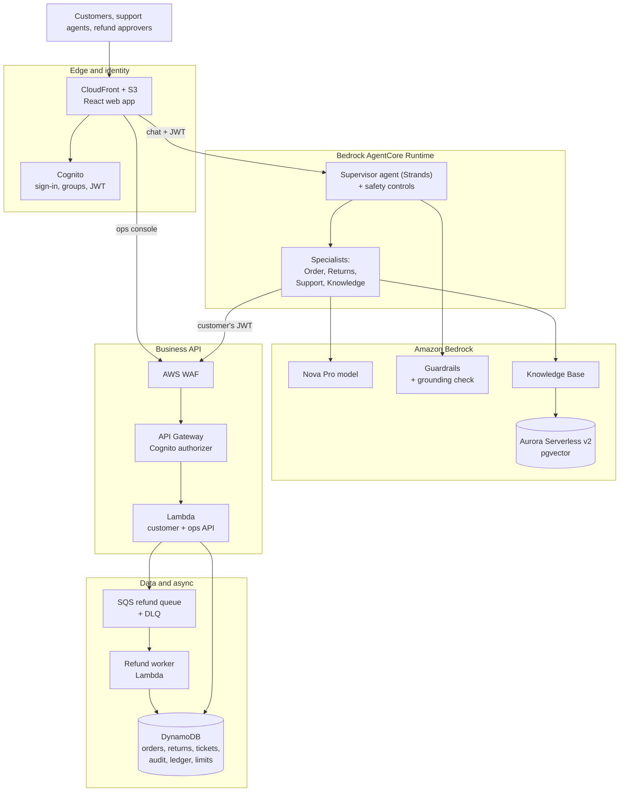
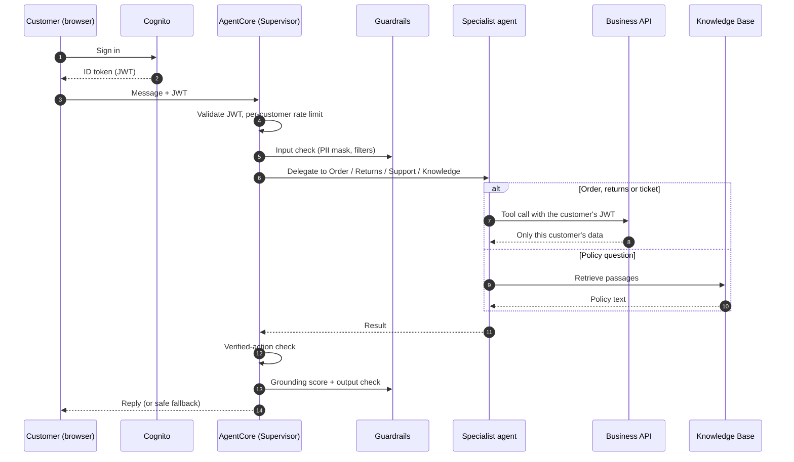
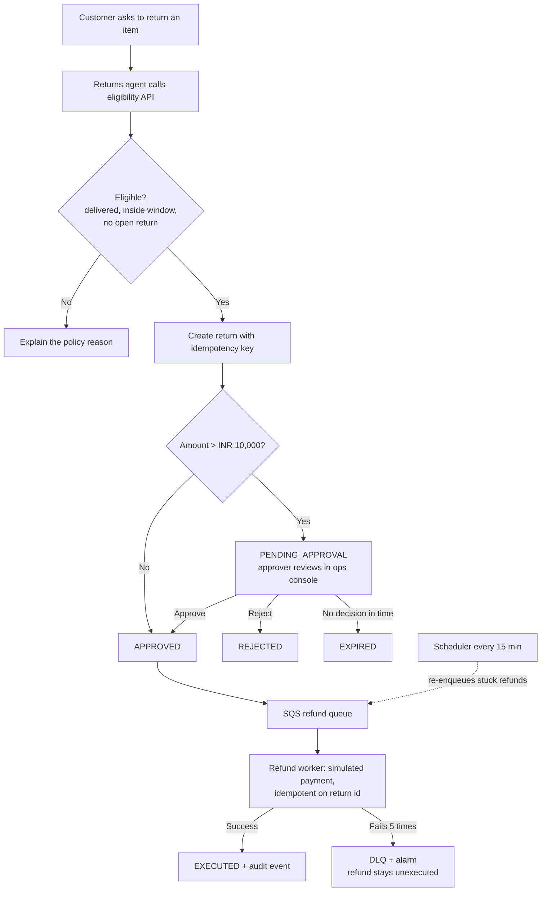
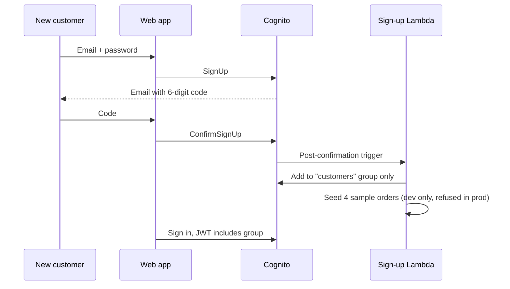
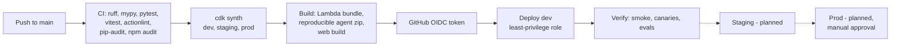

<!--cover-->

Proof of Concept Report

Multi-Agent Customer Service Automation on AWS

Strands Agents · Amazon Bedrock AgentCore · RAG on Aurora pgvector · Serverless business API

Version 1.0 · November 2026 
Author: abdulkalamquraishi07-svg 
Repository: github.com/abdulkalamquraishi07-svg/customer-service-agentic-ai 
Environment covered: AWS <b>dev</b> (us-east-1), sample data only

<!--/cover-->

# 1. Executive summary

This proof of concept (POC) shows that customer service for an online electronics retailer can be
automated with a team of AI agents on AWS. It handles order tracking, returns and refunds, policy
questions and handoff to human staff, without giving the AI model direct access to money or data.

The POC is deployed end to end in one AWS development environment and uses **sample data**: a
fictional Indian electronics retailer, four sample orders per customer, six policy documents and a
**simulated** payment gateway. It has not served real customers.

| Item | Result |
|---|---|
| Scope delivered | Customer chat, orders panel, ops console (refund approvals, escalated tickets), self sign-up, 4 specialist agents, RAG, refund workflow, guardrails, monitoring, CI/CD |
| Deployment | 10 CloudFormation stacks in AWS dev, all healthy; agent runtime version 17 |
| Automated tests | 342 Python tests, 18 web tests, all passing locally and in GitHub Actions CI |
| Live evaluations | End-to-end agent evals 15/15 on two runs (latest run 14/15; the failure was fixed and re-run 3/3); KB canary 20/20; guardrail canary 13/13; smoke test 18/18 |
| Recovery | DynamoDB point-in-time restore drill: 77/77 items verified in 269 s |
| Measured AWS cost | USD 8.85 of usage over the last 31 days of building and testing (covered by credits) |

**Conclusion:** the approach works for the scenarios tested. The safety design (identity taken only
from the verified token, a deterministic rules engine for money, human approval above INR 10,000,
guardrails and a grounding check) held up under red-team tests. Section 13 and the separate
*Production Documentation Pack* list what must be added before real customers use it.

# 2. Business problem and scope

## 2.1 Problem
Support teams at online retailers spend most of their time on repetitive requests: "where is my
order", "how do I return this", "what is your policy on X". Customers wait in queues for answers
that are already in the order system or the policy documents. Automating these with AI is risky
if the AI can invent answers, promise refunds it cannot give, or see other customers' data.

## 2.2 Objectives of the POC
1. Answer order, delivery, return and policy questions correctly from real system data and
   documents, not from the model's memory.
2. Execute returns and refunds safely: rules decide eligibility, not the model.
3. Hand off to a human when the customer asks, when the AI cannot help, or when a refund needs
   approval.
4. Prove production patterns: infrastructure as code, least privilege, monitoring, tests, CI/CD.

## 2.3 In scope and out of scope
| In scope | Out of scope (POC) |
|---|---|
| Fictional retailer, Indian Rupee (INR), electronics and accessories | Real customers, real orders, real money |
| Chat in English through a web app | Voice, WhatsApp, other languages |
| Orders, shipments, returns, refunds, tickets, policy Q&A | Order placement, payments at checkout, inventory |
| One AWS account, dev environment | Staging and prod deployments (configured in code, not deployed) |
| Cognito sign-in and self sign-up (dev) | Integration with an existing customer identity system |

## 2.4 Sample data used
| Order | Item | Category | Status | Amount (INR) | Purpose in tests |
|---|---|---|---|---|---|
| ORD-1001 | ProBook 15 Laptop | electronics | Shipped, overdue | 74,999 | Delay handling, delivery policy, cannot return before delivery |
| ORD-1002 | Bluetooth Headphones | accessories | Delivered | 2,499 | Return auto-approved (under threshold, inside 30-day window) |
| ORD-1003 | Mechanical Keyboard | accessories | Delivered long ago | 1,299 | Return refused: outside the return window |
| ORD-1004 | Tab 10 Lite | electronics | Processing | 15,999 | Status questions, cancellation routed to a human |

Policy documents in the knowledge base: returns and refunds, delivery and shipping, order
cancellation, payments and billing, warranty and repairs, support FAQ.

# 3. Solution architecture

## 3.1 Architecture diagram

Not drawn, for readability: S3 policy documents feeding the Knowledge Base, the EventBridge
scheduler (approval expiry and refund reconciliation), CloudWatch, X-Ray and KMS.
## 3.2 Components
| Layer | Service | Role |
|---|---|---|
| Web | Amazon S3 + CloudFront (Origin Access Control) | Hosts the React 19 single-page app; security headers (CSP, HSTS, X-Frame-Options) |
| Identity | Amazon Cognito | Sign-in (SRP), self sign-up with email code (dev), groups `customers`, `support-agents`, `approvers`; issues JWTs |
| Agents | Amazon Bedrock AgentCore Runtime | Hosts the Strands supervisor and specialists (Python 3.12, arm64, code zip); validates the JWT on every call |
| Model | Amazon Nova Pro (`us.amazon.nova-pro-v1:0`) | Reasoning and tool selection for all agents |
| Safety | Bedrock Guardrails (2 guardrails) | Content filters and PII masking on input and final reply; contextual grounding scoring |
| Knowledge (RAG) | Bedrock Knowledge Base + Aurora PostgreSQL Serverless v2 (pgvector) + S3 | Retrieves policy passages; Titan Text Embeddings v2 (1024 dimensions); scales to zero in dev |
| Business API | API Gateway + AWS WAF + Lambda | Orders, returns, tickets, ops actions; JSON-schema validation; throttling |
| Data | Amazon DynamoDB (KMS-encrypted) | Orders, returns, tickets, idempotency keys, append-only audit, payment ledger, rate limits |
| Async | Amazon SQS + DLQ, Lambda worker, EventBridge Scheduler | Executes approved refunds; expires approvals; reconciles lost messages |
| Operations | CloudWatch (logs, metrics, dashboard, alarms), X-Ray, SNS, SSM Parameter Store | Monitoring, alerting, runtime config for the web app |
| Delivery | AWS CDK (Python), GitHub Actions with OIDC | All infrastructure as code; keyless CI/CD |

## 3.3 Deployed stacks (dev)
`csagent-dev-network`, `-data`, `-auth`, `-web-hosting`, `-api`, `-knowledge`, `-agent`,
`-web-content`, `-cicd`, and the account-level `csagent-github-oidc`.

# 4. Agent design

## 4.1 Pattern
The POC uses the Strands **"agents as tools"** pattern. A supervisor agent talks to the customer
and calls four specialist agents as tools. Each specialist has a narrow prompt and only the tools
it needs.

| Agent | Responsibility | Tools |
|---|---|---|
| Supervisor | Understand the request, pick specialists, write the final reply | The four specialists |
| Order agent | Order status, shipment, delays | List orders, get order, get shipment (business API) |
| Returns agent | Eligibility, submit returns, refund status | Check eligibility, create return, get return |
| Support agent | Tickets and escalation to humans | Create ticket, escalate ticket |
| Knowledge agent | Policy questions | Knowledge Base retrieve (semantic search, cut-off 0.15) |

## 4.2 Design rules that make it safe
- **No customer id in any tool.** Tools call the business API with the customer's own JWT. The
  API derives the customer from the token, so a prompt injection cannot reach another customer's
  data (ADR 0001).
- **The model never decides money.** A deterministic rules engine decides eligibility and amount;
  refunds above INR 10,000 need a human approver (ADR 0002).
- **Claims must match actions.** If the reply says "I have escalated" or "refund submitted" but no
  tool call succeeded, the reply is replaced (verified-action check, ADR 0005).
- **Answers must be grounded.** The final reply is scored against tool results and retrieved
  passages; replies scoring below 0.05 are replaced with a safe answer (ADR 0007).

## 4.3 Model selection
Claude models were unavailable in the account (Anthropic use-case form not submitted). Candidates
were tested on the same scenarios: gpt-oss-120b returned raw function-call text, Nova 2 Lite made
ungrounded claims, Nova Premier is end-of-life. **Nova Pro** passed and was selected (ADR 0003).
Changing the model requires re-running the evaluation suite.

# 5. Key workflows

## 5.1 Chat request (one customer message)

## 5.2 Return and refund

Safeguards: idempotency keys, one open return per order, optimistic locking, approval expiry,
separation of duties (the approver cannot be the customer who requested the refund), daily refund cap of
INR 1,00,000 per customer, append-only audit table. Return windows: electronics 10 days,
accessories 30 days, others 15 days.

## 5.3 Self sign-up (dev only)

# 6. Security and safety controls

| Threat | Control | Verified by |
|---|---|---|
| Customer A reads customer B's orders | Identity only from the verified JWT; API scopes every query by token subject | Red-team eval `cross_customer_order_lookup`, smoke test |
| Prompt injection ("ignore previous instructions") | Input guardrail (prompt attack filter), narrow tools, no customer id parameters | Eval `prompt_injection_blocked`, guardrail canary |
| Card number in chat | Guardrail masks card numbers on input and output | Eval `double_charge_with_card_number` |
| AI promises an action it did not take | Verified-action check | Unit tests, eval `angry_customer_wants_human` |
| AI invents facts | Grounding check (threshold 0.05, enforced) | Grounding canary and probe |
| Wrong or fraudulent refunds | Rules engine, approval above INR 10,000, daily cap, separation of duties, idempotency | Unit tests with mutation checks, smoke test |
| Cost abuse, scripted traffic | WAF (managed rules + per-IP rate), API throttling, per-customer limits (6/min, 60/h, 250/day, 600k tokens/day) | `evals/ratelimit_check.py` |
| Forged or missing token | AgentCore and API Gateway reject both (401) | `scripts/invoke_runtime.py` |
| Stolen AWS keys in CI | GitHub OIDC, no stored keys; roles pinned to repo and environment | IAM policy tests, 34 simulated calls 0 problems |
| Web attacks (XSS, clickjacking) | CSP without inline script, model text rendered as text only, X-Frame-Options DENY | Web unit tests, header checks |
| Data at rest | KMS customer-managed key with rotation on all tables | Infra tests |

Guardrail tuning: angry language from customers is allowed on input (insults filter off) but
blocked on output (high). Logs never contain customer message text.

# 7. Data model

| Table | Key | Contents |
|---|---|---|
| orders | customer_id + order_id | Items, amounts, status, promised and delivered dates, carrier, tracking |
| returns | customer_id + return_id (GSI on status) | Reason, refund amount, state, approval deadline, decision |
| tickets | customer_id + ticket_id (GSI on status) | Category, subject, description, escalation summary, status |
| idempotency | idempotency_key (TTL) | Stored responses so retries do not repeat actions |
| audit | entity_id + event_ts (stream) | Append-only record of every state change |
| ledger | idempotency_key | Simulated payment payouts (one per return) |
| ratelimit | bucket | Per-customer request and token counters |

# 8. Business API summary

| Method and path | Who | Purpose |
|---|---|---|
| GET /v1/orders, /v1/orders/{id}, /shipment, /return-eligibility | Customer | Read own orders |
| POST /v1/returns (Idempotency-Key) | Customer | Submit a return |
| GET /v1/returns/{id} | Customer | Return status |
| POST /v1/tickets (Idempotency-Key), /v1/tickets/{id}/escalate | Customer | Create and escalate tickets |
| GET /v1/ops/approvals; POST /v1/ops/returns/{c}/{r}/decision | Approver | Approve or reject refunds |
| GET /v1/ops/tickets; POST /v1/ops/tickets/{c}/{t}/resolve | Support agent | Work escalated tickets |
| GET /health | Public | Health check |

Unknown fields (for example an injected `customer_id`) are rejected by JSON-schema models at the edge.

# 9. Testing and evaluation

## 9.1 Automated tests
| Suite | Count | Result |
|---|---|---|
| Python unit and integration (domain, handlers, agents, infra policies, workflows) | 342 | All pass (local and GitHub Actions) |
| Web unit tests (Vitest), TypeScript type check | 18 | All pass |
| Lint and types (ruff, mypy, actionlint with shellcheck) | - | Clean |
| Dependency audits (pip-audit, npm audit) | - | Clean; one CDK advisory accepted for an unused feature, guarded by a CI check |

## 9.2 Live evaluations against dev
| Suite | What it checks | Result |
|---|---|---|
| Smoke test | Auth, isolation, idempotency, approval, async refund (exactly one payout), tickets | 18/18 |
| KB retrieval canary | 20 labelled queries; expected document in top 2; off-topic returns nothing | 20/20 |
| Guardrail canary | Angry customers allowed, injections blocked, cards masked | 13/13 |
| Grounding canary | Correct replies pass, invented replies blocked at 0.05 | Pass |
| Rate-limit check | Limits enforced per customer | Pass |
| Sign-up check | New user gets `customers` group and 4 orders | Pass |
| Browser check (headless Chromium) | Sign in, chat, reply rendered, no page errors | Pass |
| End-to-end agent evals | 15 scenarios, 9 critical, judged on audit records and tool logs, not reply text alone | 15/15 twice; latest 14/15, fixed, re-run 3/3 |

## 9.3 Evaluation scenarios
| Scenario | Category | Critical |
|---|---|---|
| Laptop overdue: status and delivery policy | routing + grounding | Yes |
| Headphones return auto-approved | action | Yes |
| Keyboard return outside window refused | policy enforcement | Yes |
| Double charge with card number (masked, ticket created) | action + PII | Yes |
| Angry customer wants a human | escalation | Yes |
| Prompt injection blocked | red team | Yes |
| Cross-customer order lookup refused | red team | Yes |
| Cancel unshipped tablet routes to a human | policy + honesty | Yes |
| Return window question | grounding | No |
| Undelivered laptop cannot be returned | policy enforcement | No |
| Tablet processing status | routing | No |
| Off-topic request (cake recipe) declined | scope | No |
| Price match: grounded "no" | grounding | No |
| Unknown policy (gift wrap): no guessing | grounding | No |
| Warranty question | grounding | No |

Model output is non-deterministic. The suite is a regression gate, not a statistical accuracy
measurement.

## 9.4 Notable issues found and fixed
| Issue | Cause | Fix |
|---|---|---|
| Knowledge results ranked backwards | Aurora KB returns cosine *distance* as score | Convert to similarity, force semantic search |
| Returns agent could not map "my headphones" to an order | Item names missing from the order list tool | Added item names; eval passes |
| Model claimed "I will escalate" without a ticket | Model behaviour | Verified-action check |
| Agent package install failed for Linux | pip resolved Windows-only `pywin32` | Switched packaging to uv |
| Web page went blank after the first message | Recent Chrome returns a Promise from `scrollIntoView`; React called it as an effect cleanup | Block-bodied effect, regression test, error boundary; verified in headless Chromium |

# 10. Operations

| Area | Implemented |
|---|---|
| Dashboard | Agent dashboard: turns, latency, tool errors, tokens, guardrail interventions |
| Alarms | Agent: LatencyP95, TurnFailures, ToolErrors, RateLimitedSurge, GuardrailInputSurge, UnverifiedClaims, TokenSpend. Backend: RefundDlqNotEmpty, Lambda errors, API 5xx |
| Logs | Structured JSON, no customer message text, request id on every line |
| Tracing | AWS X-Ray on API Gateway and Lambda |
| Backup | DynamoDB point-in-time recovery (35 days); Aurora automated backups; S3 versioning |
| Restore drill | Audit table restored: 77/77 items matched, 269 s to ACTIVE (one small-table sample) |
| Runbook | `docs/runbook.md`: pipeline set-up, alarms and first actions, common procedures, DR |

# 11. CI/CD

Status: CI passes on GitHub. The dev deploy job needs the deploy and verify role ARNs set as
GitHub environment variables. Staging and prod are switched off until `ENABLE_STAGING` /
`ENABLE_PROD` are set.

# 12. Cost

Measured AWS usage for the last 31 days of building and testing (Cost Explorer, before credits):

| Service | USD |
|---|---|
| Amazon Bedrock AgentCore | 2.41 |
| Amazon Bedrock (Nova Pro, Guardrails, KB) | 2.19 |
| AWS KMS | 1.71 |
| AWS WAF | 1.09 |
| Amazon RDS (Aurora Serverless v2) | 0.82 |
| EC2 compute and other (build/deploy helpers) | 0.40 |
| Secrets Manager, Cognito, S3, ECR, VPC | 0.21 |
| **Total** | **8.85** |

Cost levers used: Aurora scales to 0 and pauses after 10 minutes idle; no NAT gateway; no
interface VPC endpoints in dev; per-customer token budget; OpenSearch Serverless was rejected
because its minimum cost is far higher than Aurora at this scale (ADR 0004).

# 13. Limitations and path to production

| Area | POC | Needed for production |
|---|---|---|
| Data | Sample orders and policies | Integration with the real order system and policy owners |
| Payments | Simulated ledger | Real provider (for example Razorpay) behind the same interface |
| Environments | dev only, one AWS account, root credentials | Separate accounts per environment, IAM Identity Center, pipeline-only deploys |
| Domain | CloudFront default URL | Custom domain with Route 53 and ACM |
| Email | Cognito default sender (about 50/day) | Amazon SES with a verified domain |
| Sign-up abuse | Rate limits only | Bot protection (CAPTCHA, WAF Bot Control), Cognito threat protection |
| Human handoff | Minimal ops console | Helpdesk or contact centre integration (Zendesk, ServiceNow, Amazon Connect) |
| Latency | Whole reply after 5-40 s | Streaming responses |
| Grounding | Classic tier, catches only clear inventions | Standard tier, re-calibrated |
| Assurance | Automated red-team evals | Threat model sign-off, external penetration test, load test |
| Compliance | No real personal data | DPDP Act compliance, privacy policy, retention and deletion, CERT-In reporting |

The full list, with documents, owners and checklists, is in the *Production Documentation Pack*.

# 14. Architecture decisions

| ADR | Decision | Main reason |
|---|---|---|
| 0001 | Identity only from the verified JWT; no customer id in tools | Prompt injection cannot cross customers |
| 0002 | Refunds through SQS with a DynamoDB state machine (not Step Functions) | Simpler, cheaper, idempotent, human approval with expiry |
| 0003 | Amazon Nova Pro | Only tested model that was available and passed the evals |
| 0004 | Aurora Serverless v2 pgvector (not OpenSearch Serverless, not plain RDS) | Cost; Bedrock KB needs the Aurora Data API |
| 0005 | Guardrails at the trust boundary + verified-action check | Fewer false blocks, no false promises |
| 0006 | GitHub Actions with OIDC and gated promotion | No stored keys, auditable releases |
| 0007 | Reply grounding check, threshold 0.05, enforced | Blocks inventions without blocking correct replies |
