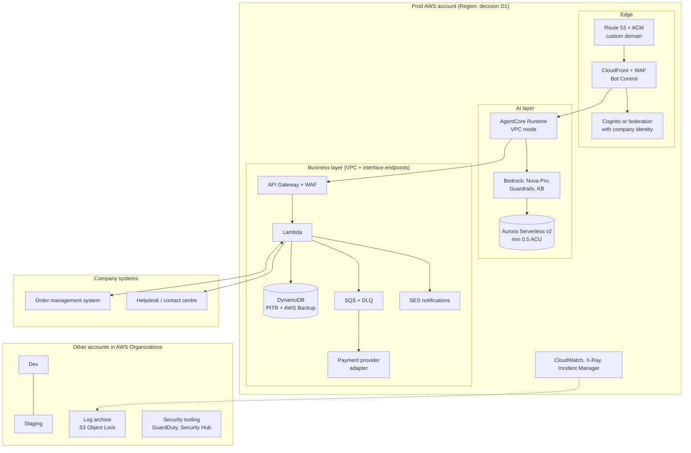

<!--cover-->

Production Documentation Pack

Multi-Agent Customer Service Automation on AWS

Architecture, operations, security, compliance, AI governance, testing and handover documents for a production deployment

Version 1.0 (draft for go-live) · November 2026 
Prepared by: abdulkalamquraishi07-svg 
Applies to: the <b>staging</b> and <b>prod</b> environments defined in <code>infra/config.py</code> 
Status: the system runs in dev with sample data. This pack contains what must be in place to run it in production.
Items in [highlighted brackets] must be completed by the operating company.

<!--/cover-->

# 0. How to use this pack

This pack covers every document a company needs once the system is deployed for real customers.
Each section is one document. Where the build already provides the content (architecture,
controls, runbook, test suites), it is filled in from the code. Where the content depends on the
company (owners, contracts, legal positions, test results that can only come from real tests),
the section is a template with placeholders.

| # | Document | Owner | Content source | State in this pack |
|---|---|---|---|---|
| 1.1 | Production solution architecture | Solution architect | Code + this pack | Complete |
| 1.2 | Architecture decision records | Solution architect | `docs/adr/` | Complete (summary) |
| 1.3 | API specification | Backend lead | Code | Complete (summary) |
| 1.4 | Data dictionary | Backend lead | Code | Complete |
| 1.5 | Network design | Cloud engineer | Code | Complete |
| 2.1 | Runbook | Operations | `docs/runbook.md` | Complete (summary) |
| 2.2 | Incident response plan | Operations + security | Template | Fill in contacts |
| 2.3 | Backup and disaster recovery plan | Operations | Code + template | Targets to approve |
| 2.4 | Monitoring and alerting catalogue | Operations | Code | Complete |
| 2.5 | Service level objectives | Product + operations | Proposed | To approve |
| 2.6 | Release and change management | Engineering manager | CI/CD + template | Approvers to name |
| 2.7 | Capacity and cost plan | Finance + architect | Estimates | To validate |
| 3.1 | Threat model | Security | This pack | To review |
| 3.2 | Security controls matrix | Security | Code | Complete |
| 3.3 | Access control policy | Security | Template | Fill in names |
| 3.4 | Vulnerability and patch management | Security | CI + template | Complete |
| 3.5 | Key and secrets management | Security | Code | Complete |
| 3.6 | Penetration test plan and report | External tester | Template | Test not yet done |
| 4.1 | Privacy notice | Legal | Draft | Legal review required |
| 4.2 | DPDP Act compliance record | Legal / DPO | Template | Legal review required |
| 4.3 | Data protection impact assessment | Legal / DPO | Draft | Legal review required |
| 4.4 | Data retention and deletion schedule | Legal + engineering | Proposed | To approve |
| 4.5 | CERT-In incident reporting procedure | Security | Template | Contacts to fill |
| 4.6 | PCI DSS scope statement | Security / QSA | Draft | Confirm with QSA |
| 4.7 | Terms of use and AI disclosure | Legal | Draft | Legal review required |
| 4.8 | Third-party and vendor register | Procurement | Template | Contracts to attach |
| 5.1 | Model card | AI lead | Code + evals | Complete |
| 5.2 | AI risk register | AI lead + risk | This pack | To review |
| 5.3 | Guardrail configuration record | AI lead | Code | Complete |
| 5.4 | Evaluation report and release gate | AI lead | Evals | Complete for dev |
| 5.5 | Human oversight procedure | Support manager | Code + template | To approve |
| 5.6 | Knowledge content governance | Policy owners | Template | Owners to name |
| 6.1 | Test strategy | QA lead | Code | Complete |
| 6.2 | Load and resilience test plan | QA lead | Plan | Test not yet done |
| 6.3 | User acceptance test plan and sign-off | Business owner | Template | Not yet run |
| 7.1 | Customer user guide | Product | Draft | Complete |
| 7.2 | Support agent and approver guide | Support manager | Draft | Complete |
| 7.3 | Handover and knowledge transfer | Engineering | This pack | Complete |
| 7.4 | Go-live checklist and sign-off | Programme manager | Checklist | To execute |

# 1. Architecture and design

## 1.1 Production solution architecture

### Target architecture

### What changes from dev to production
| Area | Dev (built) | Production |
|---|---|---|
| Accounts | One account | AWS Organizations: dev, staging, prod, log archive, security tooling |
| People access | Root user from a laptop | IAM Identity Center with MFA; root locked; break-glass procedure |
| Deployments | Manual CDK from laptop | Only through the GitHub OIDC pipeline with required reviewers |
| Network | Lambdas outside VPC, AgentCore public mode | Lambdas and AgentCore in VPC with interface endpoints (configured in `infra/config.py`) |
| Domain | `*.cloudfront.net` | Custom domains for web, API and Cognito, ACM certificates |
| Data source | Sample orders | Company order management system via API or events |
| Payments | Simulated ledger | Payment provider adapter (same `PaymentGateway` interface), webhooks |
| Email | Cognito default sender | Amazon SES, verified domain, DKIM, SPF, DMARC |
| Knowledge DB | Scales to 0 | Minimum 0.5 ACU (no cold starts) |
| Web protection | WAF on API only | WAF on CloudFront too, with Bot Control and CAPTCHA on sign-up |
| Handoff | Ops console | Helpdesk or contact centre integration |
| Audit archive | DynamoDB table | DynamoDB Streams to S3 Object Lock (WORM) in the log archive account |
| Replies | Whole reply after 5-40 s | Streaming responses |

### Open architecture decisions
| ID | Decision | Options | Owner | Decision |
|---|---|---|---|---|
| D1 | AWS Region | ap-south-1 Mumbai (data in India, CERT-In log location) vs us-east-1 (current) | [[CTO + legal]] | [[ ]] |
| D2 | Customer identity | Federate with existing customer accounts vs Cognito self sign-up | [[Product owner]] | [[ ]] |
| D3 | Payment provider | [[Razorpay / PayU / other]] | [[Finance]] | [[ ]] |
| D4 | Helpdesk | [[Zendesk / Freshdesk / ServiceNow / Amazon Connect]] | [[Support manager]] | [[ ]] |
| D5 | Model capacity | On-demand vs provisioned throughput or cross-Region inference | [[Architect]] | [[ ]] |

## 1.2 Architecture decision records (summary)
| ADR | Decision | Revisit when |
|---|---|---|
| 0001 | Customer identity only from the verified JWT; tools take no customer id | Never relax |
| 0002 | Refunds via SQS + DynamoDB state machine with human approval above INR 10,000 | Payment provider integration |
| 0003 | Amazon Nova Pro as the model | Any model change: re-run evals |
| 0004 | Aurora Serverless v2 pgvector for the knowledge base | Corpus above ~1M chunks or latency SLO missed |
| 0005 | Guardrails at the trust boundary + verified-action check | New channels or languages |
| 0006 | GitHub Actions + OIDC, environment-gated promotion | Organisation CI standard changes |
| 0007 | Grounding check, threshold 0.05 (Classic tier) | Standard tier available in CloudFormation |

## 1.3 API specification (summary)
Base path `/v1`, JSON, authenticated with a Cognito ID token in the `Authorization` header.
Mutating customer calls require an `Idempotency-Key` header. Errors return
`{"error": {"code", "message"}}` with HTTP 400, 401, 403, 404, 409, 422 or 429.

| Method | Path | Role | Notes |
|---|---|---|---|
| GET | /orders | customer | Own orders with shipment view |
| GET | /orders/{order_id} | customer | 404 for other customers' orders |
| GET | /orders/{order_id}/shipment | customer | Carrier, tracking, overdue days |
| GET | /orders/{order_id}/return-eligibility | customer | Rules engine decision and reason |
| POST | /returns | customer | Creates a return; auto-approve or pending approval |
| GET | /returns/{return_id} | customer | Status and refund state |
| POST | /tickets | customer | Creates a support ticket |
| POST | /tickets/{ticket_id}/escalate | customer | Hands the ticket to humans |
| GET | /ops/approvals | approvers | Pending refunds |
| POST | /ops/returns/{customer_id}/{return_id}/decision | approvers | `{"approve": bool, "note": str}` |
| GET | /ops/tickets?status= | support-agents | Escalated tickets |
| POST | /ops/tickets/{customer_id}/{ticket_id}/resolve | support-agents | Closes a ticket |

Action item: export a full OpenAPI 3 document from the API Gateway stage for the integration team
([[owner]], [[date]]).

## 1.4 Data dictionary
| Table | Partition key / sort key | Main attributes | Personal data | Retention (proposed) |
|---|---|---|---|---|
| orders | customer_id / order_id | items, total_amount, currency, status, ordered_at, promised_delivery_at, delivered_at, carrier, tracking_number, category, version | Customer id (pseudonymous Cognito sub) | Mirror of OMS; per OMS policy |
| returns | customer_id / return_id | order_id, reason, refund_amount, state, approval_expires_at, decided_by, note | Reason text may contain personal data | 8 years (financial records, confirm) |
| tickets | customer_id / ticket_id | category, subject, description, escalation_summary, status | Free text | 3 years after closure |
| idempotency | idempotency_key | stored response, expires_at (TTL) | Response copy | 24-48 h (TTL) |
| audit | entity_id / event_ts | actor, action, before/after state | Actor ids | 8 years, WORM archive |
| ledger | idempotency_key | payout amount, provider reference | None beyond ids | 8 years |
| ratelimit | bucket | counters, TTL | Customer id | Days (TTL) |
| Cognito user pool | sub | email, groups, MFA settings | Email | Account life + [[30]] days |
| CloudWatch logs | - | request ids, tool names, tokens, latency (no message text) | Customer id | 365 days in prod |

## 1.5 Network design
- VPC with isolated private subnets across 3 Availability Zones in prod, no NAT gateway.
- Gateway endpoints for DynamoDB and S3; interface endpoints for Bedrock, Bedrock AgentCore, SQS,
  Secrets Manager, CloudWatch Logs, KMS and STS.
- Security groups allow only HTTPS to endpoints and PostgreSQL from Bedrock KB to Aurora.
- VPC flow logs for rejected traffic.
- Public entry points are only CloudFront, API Gateway and Cognito, all behind WAF.

# 2. Operations

## 2.1 Runbook (summary of `docs/runbook.md`)
| Procedure | Steps |
|---|---|
| Refund in DLQ | Inspect message; refund is not executed; fix cause; redrive from SQS (idempotent) |
| Refund stuck APPROVED/FAILED | Scheduler re-enqueues after 10 minutes; daily cap defers to next day |
| Change policy documents | Policy owner approves; edit `data/knowledge/`; pipeline syncs the KB; evals must pass |
| Change the model | Change `MODEL_ID`; run full evals in staging; promote only if all critical scenarios pass |
| Change guardrail policy | Edit `agent_stack.py`; new guardrail version; run guardrail canary |
| Roll back the agent | Redeploy previous commit; new AgentCore runtime version; sessions drain within 15 min |
| Restore DynamoDB data | PITR into a new table, verify, copy records back; stop refund worker while repairing |

## 2.2 Incident response plan

**Severity levels**
| Severity | Definition | Examples | Response | Update cadence |
|---|---|---|---|---|
| SEV1 | Customer harm or data exposure, or full outage | Wrong refunds executing, cross-customer data shown, chat down for all | Page on-call immediately; incident commander within 15 min | Every 30 min |
| SEV2 | Major feature degraded | Refunds not executing, KB unavailable, latency p95 > 60 s | Page on-call within 15 min | Every 2 h |
| SEV3 | Minor or single-customer issue | One ticket stuck, cosmetic UI bug | Next business day | Daily |

**Roles and contacts**
| Role | Name | Phone | Backup |
|---|---|---|---|
| Incident commander | [[ ]] | [[ ]] | [[ ]] |
| On-call engineer | [[rota tool]] | [[ ]] | [[ ]] |
| Security lead | [[ ]] | [[ ]] | [[ ]] |
| Data Protection Officer / grievance officer | [[ ]] | [[ ]] | [[ ]] |
| Communications | [[ ]] | [[ ]] | [[ ]] |
| AWS support (Business/Enterprise plan) | [[case link]] | - | - |

**Steps**
1. Detect: alarm, customer report or staff report. Open an incident record ([[tool]]).
2. Triage: assign severity and incident commander.
3. Contain. Kill switches available today: block the agent path (scale AgentCore endpoint / revoke
   web client), disable the refund worker's SQS event source, tighten WAF rate limits,
   disable self sign-up in Cognito.
4. Assess legal reporting: if personal data or a cyber incident is involved, start the CERT-In
   (6 hours) and DPDP breach procedures in section 4 at once.
5. Fix and recover; verify with smoke test and evals.
6. Post-incident review within 5 business days; actions tracked to closure.

## 2.3 Backup and disaster recovery plan
| Store | Backup | Proposed RPO | Proposed RTO | Tested |
|---|---|---|---|---|
| DynamoDB tables | PITR 35 days + AWS Backup daily, cross-Region copy | 5 min | 4 h | PITR drill passed in dev (77/77, 269 s); repeat on prod-size data |
| Aurora (vectors) | Automated backups 7 days; rebuildable from S3 documents | 24 h | 2 h (re-ingest) | [[ ]] |
| S3 policy documents and web | Versioning + cross-Region replication | 0 | 1 h | [[ ]] |
| Cognito users | No native backup: export users and groups on a schedule, or federate | 24 h | 8 h | Gap to close |
| Infrastructure | CDK code in Git | 0 | 4 h (redeploy to another Region) | [[ ]] |
| Audit archive | S3 Object Lock in log archive account | 0 | n/a | [[ ]] |

DR test schedule: restore test every quarter; Region failover exercise every year
([[owner]]). RPO and RTO above are proposals until the business approves them.

## 2.4 Monitoring and alerting catalogue
| Alarm | Signal | Threshold (current) | Severity | First action |
|---|---|---|---|---|
| agent-latencyp95 | Turn latency p95 | Set in `agent_monitoring.py` | SEV2 | Check model throttling, KB cold start |
| agent-turnfailures | Failed turns | > threshold per 5 min | SEV2 | Runtime logs `turn_failed` |
| agent-toolerrors | Tool call errors | > threshold | SEV2 | Business API logs |
| agent-ratelimitedsurge | Rate-limited requests | Surge | SEV3 / SEV2 if abuse | WAF, sign-up abuse |
| agent-guardrailinputsurge | Guardrail input blocks | Surge | SEV2 | Possible attack; review samples |
| agent-unverifiedclaims | Replies replaced by verified-action check | > 0 sustained | SEV2 | Prompt or model regression |
| agent-tokenspend | Tokens per hour | 2,000,000 | SEV2 | Cost abuse; tighten limits |
| refunddlqnotempty | Refund DLQ depth | > 0 | SEV1 | Runbook: refund in DLQ |
| *errors (Lambda) | Lambda errors | > 0 per 5 min | SEV2 | Function logs by request id |
| api-5xx | API Gateway 5xx | > threshold | SEV2 | customerapi / opsapi logs |
| To add | Cost anomaly, AWS Budgets 80%/100% | [[budget]] | SEV3 | Finance + architect |
| To add | GuardDuty / Security Hub high findings | Any | SEV1/2 | Security lead |

## 2.5 Service level objectives (proposed)
| SLO | Target | Measurement |
|---|---|---|
| Chat availability | 99.5% monthly | Successful turns / all turns (excluding rate-limited) |
| Chat latency | p95 < 20 s, p50 < 8 s | AgentCore turn metric |
| Business API availability | 99.9% monthly | API Gateway 2xx+4xx / all |
| Refund execution | 99% of approved refunds executed within 15 min | Audit events |
| Escalation pickup | [[x]]% within [[y]] minutes in business hours | Helpdesk |
| Critical eval scenarios | 100% pass before every release | Release gate |

Error budget policy: if an SLO is missed for two consecutive weeks, feature releases pause until
reliability work restores it.

## 2.6 Release and change management
- All changes by pull request to `main`; CI must pass (lint, types, 342+ tests, audits, synth).
- Deploy order: dev, then staging (automatic, evals must pass), then prod (manual approval by
  [[approver 1]] and [[approver 2]] in the GitHub `prod` environment).
- Changes to prompts, model, guardrails or policy documents count as **code changes** and need
  the full eval suite in staging.
- Emergency change: incident commander may approve; review within 2 business days.
- Rollback: redeploy the previous commit through the pipeline.
- Change freeze periods: [[sale events, festive season]].

## 2.7 Capacity and cost plan (estimates to validate)
Basis: one end-to-end eval run (15 scenarios, about 22 turns) used about 110,000 input and 6,000
output tokens, i.e. roughly 5,000 input and 300 output tokens per turn. Prices change; check the
AWS pricing pages before budgeting.

| Cost item | Driver | Estimate |
|---|---|---|
| Nova Pro tokens | Turns x tokens x price | About USD 5 per 1,000 turns at on-demand list prices (verify) |
| AgentCore Runtime | Active session time | [[from staging load test]] |
| Aurora Serverless v2 | 0.5 ACU minimum, 24x7 | About USD 45/month baseline (verify for chosen Region) |
| Interface VPC endpoints | 7-8 endpoints x 3 AZ | About USD 150-170/month |
| WAF (2 web ACLs + Bot Control) | Rules + requests | [[ ]] |
| DynamoDB, Lambda, SQS, API Gateway | Requests | Low at expected volume; [[ ]] |
| KMS, CloudWatch, Backup, SES | Keys, logs, storage | [[ ]] |

Expected volume: [[conversations per day]], peak [[turns per minute]]. Bedrock quotas to request:
[[tokens per minute for Nova Pro in the chosen Region]]. Measured dev cost to date: USD 8.85 in
31 days.

# 3. Security

## 3.1 Threat model
Method: STRIDE for the platform plus the OWASP Top 10 for LLM applications for the AI layer.

| # | Threat | Asset | Mitigation in place | Residual risk / action |
|---|---|---|---|---|
| T1 | Prompt injection makes the agent act for another customer | Customer data | Identity only from JWT; tools have no customer id; API scopes by token | Low |
| T2 | Indirect injection through policy documents | Agent behaviour | Documents only from approved S3 bucket; content governance (5.6) | Medium: review process |
| T3 | Model invents policy or promises | Customer trust, legal | Grounding check, verified-action check, KB-only policy answers | Medium: Classic tier misses subtle errors (wrong carrier scored 0.19) |
| T4 | Fraudulent or duplicate refunds | Money | Rules engine, approval > INR 10,000, daily cap, idempotency, separation of duties, audit | Low |
| T5 | Account takeover | Customer data | Strong password policy, optional TOTP MFA, short tokens | Medium: add threat protection, MFA for staff mandatory |
| T6 | Mass fake sign-ups to burn model spend | Cost | Per-customer limits, token budget, alarm | High until bot protection added |
| T7 | Staff misuse of ops console | Data, money | Group-based access, audit trail | Medium: access reviews (3.3) |
| T8 | Sensitive data in logs | Privacy | No message text logged; card masking | Low |
| T9 | Leaked CI credentials | Infrastructure | OIDC, no stored keys, roles pinned to repo and environment | Low |
| T10 | Denial of service | Availability | WAF rate rules, API throttling, AgentCore limits | Medium: load test (6.2) |
| T11 | Supply-chain compromise | Code | Pinned actions by SHA, pip-audit, npm audit, lock files | Medium: add SAST and secret scanning |
| T12 | Data exfiltration by model output (system prompt, other data) | Confidentiality | Output guardrail, prompt-attack filter, no secrets in prompts | Low |

Review: [[security lead]], [[date]]. Repeat on every major change.

## 3.2 Security controls matrix
| Domain | Control | Implementation |
|---|---|---|
| Identity | Customer authentication | Cognito SRP, 12+ char passwords, optional TOTP; prod: [[federation or Cognito threat protection]] |
| Identity | Staff access | Cognito groups; prod: mandatory MFA for staff |
| Authorisation | Least privilege | One IAM role per function; table-level grants; CI roles scoped and tested |
| Data | Encryption at rest | KMS CMK with rotation on DynamoDB; S3 SSE; Aurora encrypted |
| Data | Encryption in transit | TLS 1.2+ everywhere; HSTS |
| Application | Input validation | JSON-schema models at API Gateway; unknown fields rejected |
| Application | Web security | CSP, X-Frame-Options DENY, nosniff, no HTML rendering of model output |
| AI | Guardrails | Content filters, prompt-attack filter, PII masking, grounding check |
| Abuse | Rate limiting | WAF per IP, API throttling, per-customer agent limits and token budget |
| Logging | Audit | Append-only audit table; CloudTrail [[org trail]] |
| Detection | Threat detection | Prod: GuardDuty, Security Hub, IAM Access Analyzer [[enable]] |
| Delivery | Secure pipeline | OIDC, SHA-pinned actions, required reviewers, dependency audits |

## 3.3 Access control policy
| Role | Who | Access | Approval | Review |
|---|---|---|---|---|
| Customer | Public (self sign-up or federation) | Own data through chat and API | Automatic | n/a |
| Support agent | [[team]] | Escalated tickets | Support manager | Quarterly |
| Refund approver | [[named seniors]] | Refund decisions | Finance head | Quarterly |
| Cloud administrator | [[2 named people]] | AWS prod via Identity Center, MFA | CTO | Quarterly |
| Developer | [[team]] | Dev/staging; prod read-only | Engineering manager | Quarterly |
| Break-glass | Sealed credentials | Root, used only in emergencies | CTO + security | After each use |

Leavers: access removed on the last working day. Shared accounts are not allowed.

## 3.4 Vulnerability and patch management
- Every CI run: `pip-audit`, `npm audit`, lint and type checks; failing audits block the release.
- To add before go-live: CodeQL (SAST), GitHub secret scanning and push protection, Dependabot.
- Known accepted item: `aws-cdk-lib` advisory GHSA-464c-974j-9xm6 affects CodeBuild, which is not
  used; a CI check fails if CodeBuild is added. Action: upgrade CDK before go-live.
- Patch timelines: critical 7 days, high 30 days, medium 90 days.
- Lambda and AgentCore runtimes: Python 3.12, managed by AWS; review deprecation notices quarterly.

## 3.5 Key and secrets management
| Key / secret | Purpose | Rotation | Who can use |
|---|---|---|---|
| KMS CMK (data) | DynamoDB and queue encryption | Automatic yearly | Function roles that need table access |
| Aurora credentials | KB access to pgvector | Secrets Manager [[rotation schedule]] | Bedrock KB role |
| Payment provider API keys | Refund payouts | [[provider policy]] in Secrets Manager | Refund worker only |
| Cognito | Token signing | Managed by AWS | n/a |
| CI access | Deploy | No keys: OIDC short-lived tokens | GitHub environment only |

No secrets in code, environment files or logs; secret scanning enforces this.

## 3.6 Penetration test plan and report
| Item | Detail |
|---|---|
| Scope | Web app, business API, AgentCore endpoint, Cognito flows, AI-specific attacks (prompt injection, data exfiltration, tool abuse) |
| Environment | Staging with production configuration |
| Tester | [[external firm, CERT-In empanelled if required]] |
| Dates | [[ ]] |
| AWS policy | Follow the AWS penetration testing policy (no prior approval needed for listed services) |
| Report | [[attach]]; all critical and high findings fixed before go-live |

# 4. Legal and compliance (India)

> These sections are drafts prepared by engineering to help legal counsel. They are not legal
> advice. Counsel must confirm the obligations and dates that apply to the company.

## 4.1 Privacy notice (draft)
**What we collect:** your name and email address for your account; your orders, returns and
support requests; the messages you send to our assistant.
**Why:** to answer your questions, track orders, process returns and refunds, and improve our
service. **AI assistant:** our assistant is an AI system. It uses your order information to answer
you. A person reviews refunds above INR 10,000, and you can ask for a person at any time.
**Sharing:** with our cloud provider (Amazon Web Services) and payment provider
[[name]] only to provide the service. We do not sell your data.
**Retention:** as in the retention schedule (4.4).
**Your rights:** access, correction, erasure, grievance redressal and nomination, by contacting
[[grievance officer, email]]. You may also complain to the Data Protection Board of India.

## 4.2 DPDP Act 2023 compliance record (template)
| Obligation | How the system meets it | Status |
|---|---|---|
| Notice and consent before processing | Privacy notice shown at sign-up; consent recorded with timestamp | [[to build: consent record]] |
| Purpose limitation and data minimisation | Only order, return, ticket and chat data needed for service; chat text not logged | Done |
| Accuracy | Data comes from the order system of record | Depends on OMS integration |
| Security safeguards | Section 3 controls | Done (pending pen test) |
| Personal data breach notification | Inform the Data Protection Board and affected users per DPDP Rules | Procedure in 2.2 + 4.5 |
| Erasure when purpose ends or on request | Deletion workflow across Cognito, DynamoDB and logs | [[to build]] |
| Rights of data principals | Access, correction, erasure, grievance, nomination | [[to build: request handling process]] |
| Grievance officer contact published | Privacy notice | [[name]] |
| Children's data | Verifiable parental consent if under 18; otherwise restrict sign-up | [[decision]] |
| Processor contracts | Data processing terms with AWS and payment provider | [[attach]] |
| Significant Data Fiduciary duties (if notified) | DPO in India, DPIA, audits | [[assess]] |

Implementation timeline under the DPDP Rules, 2025: [[confirm with counsel]].

## 4.3 Data protection impact assessment (draft)
| Risk | Likelihood | Impact | Mitigation | Residual |
|---|---|---|---|---|
| AI reveals another customer's data | Low | High | Identity from token; red-team evals | Low |
| Customer shares card or ID numbers in chat | Medium | High | Guardrail masking; no text logging | Low |
| Wrong refund decision affects customer | Low | Medium | Rules engine; human approval; appeal through human agent | Low |
| Profiling or automated decisions | Low | Medium | No profiling; refund rules are transparent and published | Low |
| Data transferred outside India (if us-east-1) | High (current design) | Medium | Decision D1; processor terms | [[legal]] |
| Retention longer than necessary | Medium | Medium | Retention schedule and TTLs | [[after 4.4 approved]] |

## 4.4 Data retention and deletion schedule (proposed)
| Data | Retention | Deletion method |
|---|---|---|
| Account (Cognito) | While active + [[30]] days after closure request | Admin delete + workflow |
| Orders (mirror) | Per OMS policy | OMS-driven |
| Returns, refunds, ledger, audit | [[8 years]] (tax and accounting, confirm) | Scheduled purge; WORM archive expiry |
| Tickets | 3 years after closure | Scheduled purge |
| Chat session memory (AgentCore) | Session lifetime (idle timeout 15 min) | Automatic |
| Application logs | 365 days (meets CERT-In 180-day minimum) | CloudWatch retention |
| Idempotency, rate-limit counters | Hours to days | DynamoDB TTL |
| Backups | 35 days PITR; AWS Backup [[x]] days | Automatic expiry |

## 4.5 CERT-In incident reporting procedure (template)
- Report notifiable cyber security incidents to CERT-In **within 6 hours** of noticing them
  (CERT-In Directions of 28 April 2022), using the CERT-In reporting format.
- Point of contact registered with CERT-In: [[name, email, phone]].
- Keep ICT system logs for 180 days **within Indian jurisdiction**: affects decision D1 (Region
  or log copy to ap-south-1).
- Synchronise clocks with NTP (AWS services use the Amazon Time Sync Service).
- Steps: security lead confirms the incident type, prepares the report, legal approves, submits
  to incident@cert-in.org.in [[confirm current channel]], records the submission in the incident.

## 4.6 PCI DSS scope statement (draft)
- The system does **not** store, process or transmit cardholder data by design. Refunds are paid
  through the payment provider using the original payment reference.
- Customers may type card numbers into chat by mistake. The input guardrail masks them before the
  model sees them, and message text is not logged.
- Target: keep the platform out of PCI DSS cardholder data environment scope; payment pages
  hosted by the provider (SAQ A style). [[Confirm with QSA]].

## 4.7 Terms of use and AI disclosure (draft)
"You are chatting with an AI assistant. It can make mistakes. It can check your orders, explain
our policies, start returns and connect you with a person. Refunds follow our published returns
policy; refunds above INR 10,000 are reviewed by a person. Ask for a human at any time."
Full terms: [[legal]].

## 4.8 Third-party and vendor register
| Vendor | Service | Data shared | Contract / DPA | Region |
|---|---|---|---|---|
| Amazon Web Services | Hosting, AI models (Amazon Nova), email | All system data | AWS Customer Agreement + DPA | [[D1]] |
| GitHub | Source code, CI/CD | Code only, no customer data | [[ ]] | n/a |
| [[Payment provider]] | Refund payouts | Order and payment references | [[ ]] | India |
| [[Helpdesk]] | Human handoff | Ticket contents | [[ ]] | [[ ]] |

# 5. AI governance

## 5.1 Model card
| Field | Value |
|---|---|
| System | Multi-agent customer service assistant (supervisor + 4 specialists) |
| Model | Amazon Nova Pro, `us.amazon.nova-pro-v1:0`, via Bedrock (cross-Region inference profile) |
| Embeddings | Amazon Titan Text Embeddings v2, 1024 dimensions |
| Intended use | Answer order, delivery, return, refund and policy questions; start returns; escalate to humans |
| Not intended for | Financial advice, decisions outside the published policy, medical or legal advice, order placement |
| Users | Retail customers (English), support staff |
| Decision authority | None on money: the rules engine decides eligibility; humans approve above INR 10,000 |
| Known limitations | Non-deterministic output; 5-40 s replies; grounding check misses subtle factual errors; English only |
| Evaluation | 15 scenarios incl. 9 critical; KB, guardrail and grounding canaries (5.4) |
| Alternatives tested | gpt-oss-120b (raw function-call text), Nova 2 Lite (ungrounded claims), Nova Premier (end of life); Claude not enabled |

## 5.2 AI risk register
| ID | Risk | Control | Monitoring | Owner |
|---|---|---|---|---|
| A1 | Hallucinated policy or facts | KB-grounded answers, grounding check, eval gate | Grounding interventions metric | [[AI lead]] |
| A2 | False action claims | Verified-action check | UnverifiedClaims alarm | [[AI lead]] |
| A3 | Prompt injection / jailbreak | Prompt-attack filter, narrow tools, identity from token | GuardrailInputSurge alarm, red-team evals | [[Security]] |
| A4 | Harmful or rude output | Output content filters (insults HIGH) | Guardrail metrics | [[AI lead]] |
| A5 | Model drift after provider update | Pinned model id, eval gate on change, scheduled weekly eval run | Eval results | [[AI lead]] |
| A6 | Unfair treatment | Same rules engine for every customer; no profiling | Complaint review | [[Support manager]] |
| A7 | Over-reliance; customer cannot reach a human | Human button always visible, escalation tool | Escalation rate | [[Support manager]] |
| A8 | Cost runaway | Token budget, rate limits, TokenSpend alarm | Cost dashboard | [[Architect]] |

## 5.3 Guardrail configuration record
| Guardrail | Setting | Input | Output | Reason |
|---|---|---|---|---|
| customer-chat | Prompt attack | HIGH | NONE | Output cannot carry prompt attacks |
| customer-chat | Insults | NONE | HIGH | Angry customers must still be helped; the assistant must never insult |
| customer-chat | Hate, sexual | HIGH | HIGH | Standard content safety |
| customer-chat | Violence, misconduct | MEDIUM | HIGH | Customers describe problems ("it broke", "I'll sue") without being blocked |
| customer-chat | Card numbers | Masked | Masked | PCI and privacy |
| reply-grounding | Contextual grounding | - | Score only, threshold 0.05 enforced in code | Calibrated: correct replies 0.10-0.99, inventions 0.00-0.03 |

Change procedure: edit in code, new guardrail version, guardrail canary 13/13 and full evals
before promotion. Calibration evidence: ADR 0007.

## 5.4 Evaluation report and release gate
Latest results in dev: end-to-end 15/15 on two consecutive runs (latest 14/15, failure fixed and
re-run 3/3); KB canary 20/20; guardrail canary 13/13; grounding canary pass; smoke 18/18.

**Release gate (every prod release):** all 9 critical scenarios pass; at least 14 of 15 overall;
KB, guardrail and grounding canaries pass; smoke test passes. In production, add a weekly
scheduled eval run and sample [[n]] real conversations per week for human review.

## 5.5 Human oversight procedure
| Trigger | What happens | Who | Target time |
|---|---|---|---|
| Customer asks for a person | Ticket escalated to queue | Support agent | [[ ]] |
| Refund above INR 10,000 | Pending approval in ops console; expires if not decided | Approver | [[ ]] |
| Agent cannot help (policy unknown, cancellation) | Offers escalation | Support agent | [[ ]] |
| Repeated failures or angry customer | Escalation suggested in reply | Support agent | [[ ]] |
| Customer disputes an AI answer | Human review; correction recorded | Support manager | [[ ]] |

## 5.6 Knowledge content governance
- Each policy document has an owner: returns [[ ]], delivery [[ ]], cancellation [[ ]], payments
  [[ ]], warranty [[ ]], FAQ [[ ]].
- Changes by pull request with owner approval; tests check that documents match backend rules
  (return windows, thresholds).
- Review every [[6]] months or when a policy changes; KB re-sync and canary run on every change.

# 6. Testing and quality

## 6.1 Test strategy
| Level | Tool | Gate |
|---|---|---|
| Unit and integration | pytest with moto (AWS mocks), Vitest | Every pull request |
| Infrastructure policy tests | CDK assertions | Every pull request |
| Mutation checks on safeguards | Disable a safeguard, tests must fail | On change to safeguards |
| Smoke | `scripts/smoke_test.py` | Every deploy |
| Canaries | KB, guardrail, grounding, rate limit, sign-up | Every deploy |
| End-to-end evals | `evals/run_evals.py` | Every staging deploy, weekly in prod |
| Browser | `scripts/browser_repro.py` (headless Chromium) | Every web release |
| Load and resilience | k6 / Distributed Load Testing on AWS, AWS FIS | Before go-live, then yearly |
| Security | Pen test, SAST | Before go-live, then yearly |

## 6.2 Load and resilience test plan
| Test | Load profile | Pass criteria | Result |
|---|---|---|---|
| Baseline | [[expected peak]] turns/min for 30 min | p95 < 20 s, error rate < 1% | [[ ]] |
| Peak (sale day) | 3x expected peak for 15 min | p95 < 30 s, no refund errors | [[ ]] |
| Soak | Expected load for 4 h | No growth in errors or latency | [[ ]] |
| Bedrock throttling | Exceed quota | Friendly retry message, no failed refunds | [[ ]] |
| Fault injection | Kill Lambda, block SQS, pause Aurora | Alarms fire; refunds recover via reconciler | [[ ]] |

## 6.3 User acceptance test plan and sign-off
| # | Test case | Expected result | Pass/Fail | Tester |
|---|---|---|---|---|
| U1 | Customer signs up, confirms email, signs in | Account works, sees own orders | [[ ]] | [[ ]] |
| U2 | Ask for delayed order status | Correct status, carrier, delay policy | [[ ]] | [[ ]] |
| U3 | Return item inside window, under INR 10,000 | Return approved, refund executed | [[ ]] | [[ ]] |
| U4 | Return item above INR 10,000 | Pending approval; approver approves; refund executed | [[ ]] | [[ ]] |
| U5 | Return outside window | Refused with policy reason | [[ ]] | [[ ]] |
| U6 | Ask for a human | Ticket appears in ops console | [[ ]] | [[ ]] |
| U7 | Policy question not in documents | Says it does not know, offers human | [[ ]] | [[ ]] |
| U8 | Type a card number | Masked in reply | [[ ]] | [[ ]] |
| U9 | Approver tries to approve own refund | Blocked | [[ ]] | [[ ]] |
| U10 | Mobile browser | Usable layout | [[ ]] | [[ ]] |

Sign-off: business owner [[name, date]]; support manager [[name, date]].

# 7. Business and handover

## 7.1 Customer user guide
1. Open [[support.company.com]] and sign in, or choose **Create an account**, enter your email and
   a password (12+ characters with upper and lower case, a number and a symbol), then type the
   6-digit code we email you.
2. Type your question, for example "Where is my laptop?" or "I want to return my headphones".
   Your orders are listed on the right.
3. Answers take a few seconds. The assistant can check orders, explain policies, start returns and
   create support tickets.
4. Choose **Talk to a human** at any time. Choose **New conversation** to start over.
5. Never share full card numbers or passwords in chat.

## 7.2 Support agent and approver guide
- Sign in with your staff account (MFA required in production). Staff land on the **ops console**.
- **Support agents:** the queue shows escalated tickets with the AI's escalation summary. Contact
  the customer through [[helpdesk]] and choose **Resolve** when done.
- **Approvers:** the queue shows refunds above INR 10,000 with order, reason, amount and deadline.
  Approve or reject with a note. Undecided refunds expire at the deadline. You cannot approve a
  refund you requested yourself.
- Every decision is written to the audit trail.

## 7.3 Handover and knowledge transfer
| Topic | Where |
|---|---|
| Code and structure | Repository README; `services/` (core, business API, agents), `infra/`, `web/` |
| Decisions | `docs/adr/0001-0007` |
| Operations | `docs/runbook.md` |
| Production gaps | `docs/production-readiness.md` |
| Tests and evals | `pytest`, `web/` Vitest, `evals/`, `scripts/smoke_test.py` |
| Environments and config | `infra/config.py` |
| Knowledge transfer sessions | [[dates]]: architecture, agents and prompts, operations and incidents |

## 7.4 Go-live checklist and sign-off
| # | Item | Owner | Done |
|---|---|---|---|
| 1 | Architecture decisions D1-D5 made | CTO | [ ] |
| 2 | Prod and staging accounts created; Identity Center with MFA; root locked | Cloud admin | [ ] |
| 3 | Staging deployed by pipeline; full evals pass | Engineering | [ ] |
| 4 | Real order system and payment provider integrated and tested | Engineering | [ ] |
| 5 | Custom domains, ACM, SES with DKIM/SPF/DMARC | Cloud admin | [ ] |
| 6 | WAF on CloudFront with Bot Control; CAPTCHA on sign-up | Security | [ ] |
| 7 | Threat model reviewed; pen test done; critical/high fixed | Security | [ ] |
| 8 | Load test passed; Bedrock quotas raised | QA + architect | [ ] |
| 9 | Backups (AWS Backup, cross-Region) configured; restore tested on prod-size data | Operations | [ ] |
| 10 | Alarms routed to paging; on-call rota live; incident plan contacts filled | Operations | [ ] |
| 11 | Budgets and cost anomaly detection on | Finance | [ ] |
| 12 | Privacy notice, terms, AI disclosure published; DPDP record complete | Legal | [ ] |
| 13 | CERT-In point of contact registered; log location decided | Security + legal | [ ] |
| 14 | Retention and deletion workflow built | Engineering | [ ] |
| 15 | Policy document owners named; content reviewed | Policy owners | [ ] |
| 16 | UAT passed and signed | Business owner | [ ] |
| 17 | Support staff trained; helpdesk integration live | Support manager | [ ] |
| 18 | Rollback tested in staging | Engineering | [ ] |
| 19 | CDK upgraded; CodeQL and secret scanning on | Engineering | [ ] |
| 20 | Launch plan: soft launch to [[x]]% of customers, then full | Product | [ ] |

| Sign-off | Name | Signature | Date |
|---|---|---|---|
| Business owner | [[ ]] | | |
| CTO / technical owner | [[ ]] | | |
| Security lead | [[ ]] | | |
| Data Protection Officer / legal | [[ ]] | | |
| Operations lead | [[ ]] | | |
